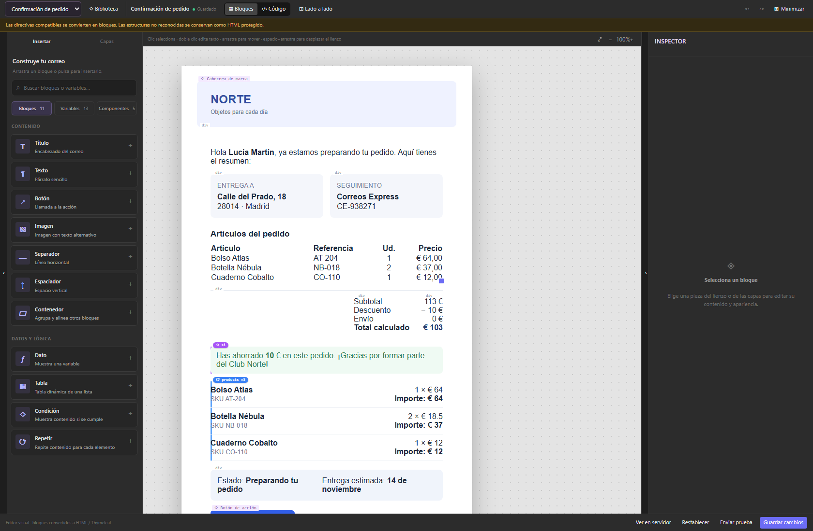

# MailCanvas

**Editor visual de correos con lienzo tipo Figma.** Componente React y TypeScript reutilizable para componer correos con bloques, datos dinámicos y componentes compartidos. Incluye una demo independiente, lienzo visual, edición HTML/Thymeleaf en Monaco y vista previa local.



## Ejecutar

Requisitos: Node.js 20.19+ o 22.12+ y npm. Esta revisión se ha capturado con Node.js 24 y Chromium.

```sh
npm install
npm run dev
```

Abre la dirección indicada por Vite. El servidor de desarrollo escucha en todas las interfaces; el generador de capturas usa solo `127.0.0.1`.

## Documentación actual

| Documento | Contenido |
| --- | --- |
| [Reescrituras por pasos](docs/REWRITE-STEPS.md) | Cinco cambios independientes, validaciones y capturas |
| [Inventario técnico](docs/TECHNICAL-FEATURES.md) | Funciones y contratos de 1.0.3 antes de la reescritura |
| [Comparación de la reescritura](docs/REWRITE-COMPARISON.md) | Arquitectura, pruebas, tamaños y diferencias visuales |
| [Integración React](docs/REACT-COMPONENT.md) | Paquete instalable, props, estilos, React 18/19 y ejemplo de consumo |
| [Guía de uso](docs/GUIA-DE-USO.md) | Interfaz, variables, T / ƒ, capas, tablas y componentes |
| [Arquitectura e integración](docs/ARQUITECTURA.md) | API, modelos, serialización y organización del código |
| [Componentes y Yambo](docs/COMPONENTS.md) | Originales, instancias y límites de integración |
| [Validación y capturas](docs/VALIDACION.md) | Pruebas, reproducción y cobertura visual |
| [Galería visual](docs/screenshots/index.html) | 21 capturas nuevas con filtros y PNG originales |
| [Inventario de capturas](docs/screenshots/manifest.json) | Archivos, navegador, resolución y fecha |

La galería HTML se puede abrir directamente desde el disco. `artifacts/visual/` conserva experimentos y comparaciones anteriores; las capturas actuales están en `docs/screenshots/`.

## Funciones actuales

- Apertura maximizada y opción de volver a la vista reducida.
- Insertar: bloques, árbol de variables tipadas y biblioteca de componentes.
- Capas con búsqueda, grupos desplegables y arrastre desde el nombre o la fila del bloque.
- Lienzo con selección, texto editable, desplazamiento, zoom y arrastre de bloques.
- Inspector organizado en Contenido, Diseño y Avanzado.
- Campos compartidos T | ƒ para texto literal o `${variable}`, cálculos y texto interpolado.
- Tablas con columnas configurables y varias fuentes de filas bajo una misma cabecera.
- Componentes vinculados a originales compartidos, propiedades locales y restablecimiento.
- Seis correos de demo, siete componentes compartidos y un laboratorio con guardado local, fallos simulados, datos estructurados e importación/exportación. Consulta [la guía de la demo](docs/DEMO.md).
- Vista previa aislada con opciones de escritorio y móvil.

```text
${cliente.nombre}
Referencia: ${item.sku}
${item.quantity * item.unitPrice} €
Pedido ${pedido} · ${nombre}
```

En T, `${pedido}` se conserva como texto. En ƒ, se resuelve con los datos. El parser acepta también `{{nombre}}` y `{{= expresión}}` de versiones anteriores; la interfaz muestra `${…}`.

## Comandos

| Comando | Uso |
| --- | --- |
| `npm run dev` | Desarrollo con Vite |
| `npm run build` | Demo en `demo-dist/` y librería en `dist/` |
| `npm run build:lib` | Librería ESM, CSS y declaraciones TypeScript |
| `npm run build:demo` | Aplicación de demostración |
| `npm run dev:component` | Ejemplo que consume la librería compilada |
| `npm run preview` | Servir la compilación local |
| `npm test` | Suite de Vitest |
| `npm run test:watch` | Pruebas en observación |
| `npm run docs:screenshots` | Capturas, manifiesto y galería HTML |

Playwright y Chromium son requisitos opcionales del generador de capturas, no dependencias de ejecución del editor. Consulta [Validación](docs/VALIDACION.md).

## Usarlo en otra aplicación React

```tsx
import { EmailEditor } from "mailcanvas";
import "mailcanvas/style.css";

<EmailEditor value={html} onChange={setHtml} style={{ height: 720, minHeight: 0 }} />
```

El componente se integra en su contenedor por defecto. Usa `defaultMaximized` para abrirlo maximizado, como hace la demo. Para crear un archivo instalable localmente, ejecuta `npm run build:lib` y `npm pack --ignore-scripts --pack-destination artifacts`. Este comando solo crea el archivo local. Consulta la [guía de integración React](docs/REACT-COMPONENT.md).

## Alcance

La demo guarda borradores y biblioteca en localStorage al confirmar Guardar. Recargar recupera la última versión guardada. Las pruebas de envío y de servidor se simulan en la demo. La aplicación consumidora aporta sus callbacks y almacenamiento.

El renderizador local implementa un subconjunto de Thymeleaf. La preview no certifica compatibilidad con Outlook, Gmail u otros clientes. La integración real debe resolver las referencias compartidas y validar el HTML con el motor del servidor.

Documentación revisada el **12 de noviembre de 2026**.

## Licencia y publicación

Licencia [MIT](LICENSE). Las dependencias distribuidas conservan sus [avisos de terceros](THIRD_PARTY_LICENSES.txt).

GitHub Actions valida pruebas, compilación y consumo del componente. El workflow de publicación publica en npm al crear una release o ejecutarse manualmente sobre un tag. Consulta [CI y publicación](docs/CI-Y-PUBLICACION.md) para configurar npm y la primera versión.
