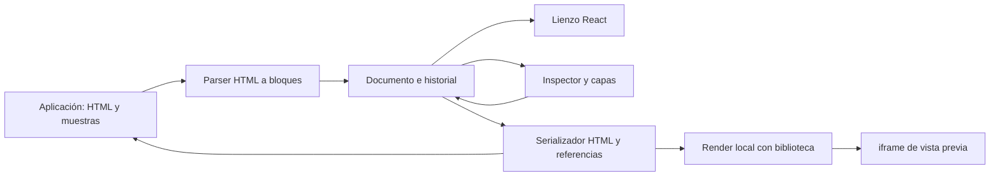

# Arquitectura e integración

[Inicio](../README.md) · [Guía de uso](GUIA-DE-USO.md) · [Validación](VALIDACION.md)

## Flujo de datos



`EmailEditor` es controlado por `value` y `onChange`. EditorDocument conserva instantáneas de HTML y bloques, historial y la fuente guardada. Cada transacción publica su estado antes de notificar al host. Una cola de fuentes emitidas reconoce acknowledgements tardíos y los distingue de importaciones externas. useEditorDocument conecta este almacén con React mediante useSyncExternalStore.

El lienzo usa elementos React del documento principal. La preview utiliza un `iframe` con `sandbox=""`. El zoom transforma visualmente el lienzo; no cambia el ancho de composición del correo.

## API pública

La entrada del paquete es `src/index.ts`, compilada como ESM y tipos en `dist/`. La demo tiene una salida independiente en `demo-dist/`. La instalación y los ejemplos públicos están en [REACT-COMPONENT.md](REACT-COMPONENT.md).

| Propiedad | Tipo / propósito |
| --- | --- |
| `value` | HTML editable, `string` |
| `onChange` | `(html: string) => void` |
| `tokens` | `EmailToken[]`: token, etiqueta, `varName` y `sample` |
| `templateKey` | Clave del contexto de plantilla |
| `commonElements` | Envoltura y catálogo de componentes |
| `navigation` | `ReactNode` opcional para navegación externa |
| `className`, `style` | Personalización del contenedor integrado |
| `defaultMaximized`, `maximized`, `onMaximizedChange` | Tamaño inicial o controlado; integrado por defecto |
| `title` | Título de la barra |
| `onSave`, `onReset`, `onSendTest`, `onServerPreview` | Callbacks opcionales sin parámetros; el padre conserva la fuente actual |

```tsx
import { useState } from "react";
import EmailEditor from "./src/components/EmailEditor";
import type { EmailToken } from "./src/services/emailTemplateRenderer";

const tokens: EmailToken[] = [
  { token: "{{nombre}}", label: "Nombre", varName: "nombre", sample: "Lucía" },
];

export default function App() {
  const [html, setHtml] = useState('<p>Hola <span th:text="${nombre}">Nombre</span></p>');
  return <EmailEditor value={html} onChange={setHtml} tokens={tokens} />;
}
```

`token` conserva el identificador histórico del contrato; los campos de la interfaz usan `${…}`. Para varios documentos, el padre mantiene un mapa de fuentes y monta el editor con `key={documentId}`. El HTML se conserva por documento; el estado de edición se reinicia al cambiar de clave.

`CommonElements` admite `headerHtml`, `footerHtml`, organización, color/icono/título de cabecera, `showEnvelopeHeader` y `components`. La demo oculta la cabecera automática de la envoltura porque muestra cabecera y pie como instancias explícitas.

## Modelos

### Bloques

`EmailBlock`, en `emailBlocks.ts`, es una unión discriminada: contenido, imagen, botón, tabla, contenedor, condición, repetición, HTML protegido e instancia de componente. Cada bloque tiene un identificador y puede conservar estilos, clase y atributos permitidos.

Contenedores, condiciones y repeticiones tienen hijos. Celdas y grupos de filas pertenecen a la tabla. Una instancia es una referencia atómica; sus capas internas no se convierten en hijos independientes del documento.

### Tablas

`fields` guarda identificadores estables y orden. `columnLabels`, `columnWidths`, `columnAlignments` y `columnFormats` describen la presentación. `rowGroups` combina fuentes repetidas y filas únicas.

```ts
const rowGroups = [
  {
    id: "productos", type: "repeat", collection: "products",
    cells: {
      concepto: { mode: "template", value: "${item.name}" },
      importe: { mode: "template", value: "${item.qty * item.price}" },
    },
  },
  {
    id: "envio", type: "single",
    cells: {
      concepto: { mode: "text", value: "Envío" },
      importe: { mode: "template", value: "${costeEnvio}" },
    },
  },
];
```

Hay tres representaciones internas de celda: texto, expresión desnuda y plantilla con marcadores. La UI las reduce a T y ƒ. Las tablas antiguas sin `rowGroups` derivan un grupo repetido de `collection` y `fields`.

El serializador emite cabecera y filas `tr` con `th:each` cuando procede. Los metadatos `data-ee-*` permiten recuperar identificadores, fuentes y formatos desde Código. Reordenar columnas cambia `fields`, no las claves de los valores de cada grupo.

### Componentes

`EmailComponent` define un original con clave, nombre, categoría, HTML y propiedades tipadas. La instancia conserva la clave, personalizaciones y un respaldo de HTML/esquema. Los valores son literales o expresiones, con soporte de texto interpolado.

La resolución utiliza el catálogo vigente para lo no personalizado. El respaldo permite reabrir la fuente sin la definición. La expansión de componentes anidados tiene un límite de profundidad; no es composición ilimitada ni un editor visual completo del original.

Consulta [COMPONENTS.md](COMPONENTS.md) para el contrato de Yambo y la persistencia/resolución que falta integrar en el servidor.

## Inputs compartidos

- `ValueInput.tsx`: selector T/ƒ, presentación `${…}` y borrador estable al escribir.
- `ExpressionInput.tsx`: sugerencias, cursor, teclado y cierre de marcadores.
- `valueSyntax.ts`: extracción, normalización y conversión de texto interpolado.
- `InlineSyntaxEditor.tsx`: texto multilínea con resaltado y sugerencias.
- `inlineTextModel.ts`: texto, variables y edición por rangos.

El modo literal no evalúa marcadores. El evaluador preserva `${…}` dentro de cadenas entre comillas para no convertir T en ƒ accidentalmente.

## Render y compatibilidad

`renderEmail` crea el contexto, resuelve componentes, procesa directivas y aplica la envoltura. `renderThymeleaf` renderiza un fragmento sin envoltura.

El evaluador no usa `eval`. Implementa rutas, literales, operadores admitidos, algunas operaciones de colecciones y la variante decimal usada por el editor. No ofrece soporte general de todos los métodos Thymeleaf, utilidades `#…`, SpringEL ni dialecto Layout.

Preservar HTML protegido no equivale a importarlo estructuralmente. Revisa tablas externas con combinaciones de celdas, estilos por fila o firmas no compatibles: no se garantiza round-trip sin pérdidas para cualquier HTML. Los escenarios probados están en [Validación](VALIDACION.md).

## Organización

| Archivo | Responsabilidad |
| --- | --- |
| `demo/EmailEditorDemo.tsx` | Documentos, biblioteca y acciones simuladas |
| `demo/componentLibrary.ts` | Originales y tres correos de muestra |
| `demo/ComponentLibraryManager.tsx` | Diálogo de originales |
| `src/components/EmailEditor.tsx` | Composición, paneles y acciones |
| `src/components/email-editor/useEmailEditor.ts` | Estado, selección y publicación |
| `src/editor/EditorDocument.ts` | Transacciones, historial completo y sincronización del documento |
| `src/editor/usePointerSession.ts` | Finalización y cancelación de gestos |
| `src/editor/useCanvasViewport.ts` | Cámara, foco, pan, zoom y destinos de arrastre |
| `src/editor/canvasGeometry.ts` | Medidas y unidades fijadas al comenzar un gesto |
| `demo/useDemoSession.ts` | Datos, documentos, biblioteca y persistencia de la demo |
| `src/components/editor/Workspace.tsx` | Lienzo, pan, zoom y arrastre |
| `src/components/editor/BlockRenderer.tsx` | Bloques editables y repeticiones |
| `src/components/editor/LayerPanel.tsx` | Árbol, búsqueda y arrastre de filas |
| `src/components/editor/TableInspector.tsx` | Columnas, fuentes y resultados |
| `src/components/editor/ComponentInspector.tsx` | Propiedades locales |
| `src/services/emailBlocks.ts` | Tipos, parser y serialización |
| `src/services/emailBlockTree.ts` | Operaciones de árbol |
| `src/services/tableRows.ts` | Filas y formato de columna |
| `src/services/emailComponents.ts` | Referencias y expansión |
| `src/services/emailTemplateRenderer.ts` | Contexto y render local |
| `src/services/thymeleafExpression.ts` | Evaluación limitada |
| `scripts/capture-docs.mjs` | Capturas y galería documental |

## Integración real

El lienzo sanea fragmentos antes de insertarlos y la preview está aislada. Eso no reemplaza la validación de plantillas y enlaces en el servicio de envío.

El padre conecta persistencia, catálogo, envío y render del servidor. La demo no tiene autenticación, API de Yambo ni almacenamiento permanente; las actualizaciones de biblioteca solo se resuelven dentro de su sesión.
