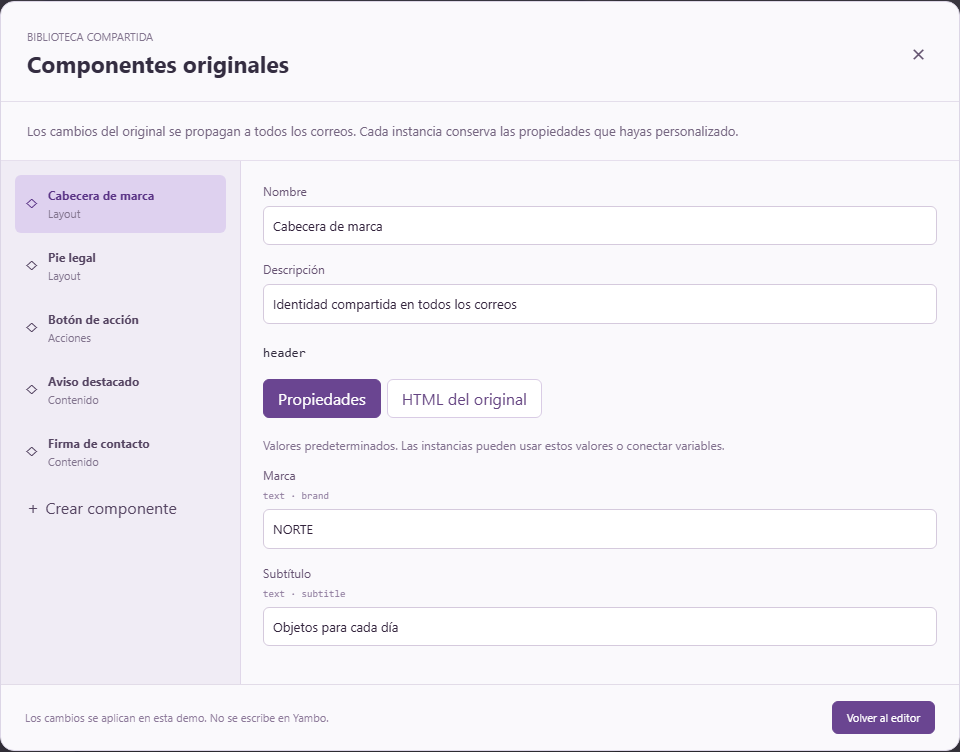

# Componentes de correo y encaje con Yambo

[Inicio](../README.md) · [Guía de uso](GUIA-DE-USO.md) · [Arquitectura](ARQUITECTURA.md) · [Galería actual](screenshots/index.html)

Revisión: 12 de noviembre de 2026.

## Lo observado en C:/code/yambo

- `backend/src/main/resources/templates/emails/layout/base-email.html`: layout heredado con `layout:decorate`, hueco de contenido y cabecera/pie centralizados.
- `backend/src/main/resources/templates/emails/fragments/layout.html`: fragmentos parametrizados `productTable`, `orderDetails`, `ctaButton` e `issueDetails`.
- `frontend/app/services/emailCommonElementService.ts`: catálogo de elementos comunes mediante `/email-common-elements`.
- `backend/src/main/java/es/yambo_alco/web/service/EmailCommonElementService.java`: cabecera/pie con claves reservadas; los componentes adicionales se almacenan como HTML. El contrato actual no incluye un esquema de propiedades ni un resolvedor de referencias de instancia.

Solo se ha leído este proyecto. No se han modificado archivos, datos ni APIs de Yambo.

## Modelo del prototipo

`EmailComponent` describe un original: clave estable, nombre, HTML y propiedades tipadas (texto, enlace, color y booleano). Un bloque `component` guarda la clave, los valores personalizados y un respaldo de HTML/esquema. No expone su estructura interna como bloques independientes: se personalizan sus propiedades.

Las propiedades sin personalizar siguen los valores actuales de la biblioteca. Una propiedad personalizada puede ser un literal o una expresión evaluada con el contexto del correo. Restablecerla elimina la personalización, por lo que vuelve a seguir el original. La biblioteca es compartida por todos los correos de la demo; los documentos mantienen sus propias instancias.

El código editable conserva referencias `data-ee-component` y parámetros `data-ee-component-values`. El respaldo incluye HTML y asignaciones Thymeleaf `th:with`. Al renderizar, las referencias se resuelven con la biblioteca actual. El render final de ejemplo evalúa esas asignaciones y los campos de la plantilla; los atributos `data-ee-*` son metadatos del editor, no llamadas a una API de Yambo.

Esto permite reabrir el documento conservando referencias, recuperar un componente no disponible con su respaldo y actualizar originales sin sobreescribir los valores locales. No constituye una implementación de todo el dialecto Layout de Thymeleaf.

## Integración posterior

1. Mapear los originales al catálogo de elementos comunes y añadir persistencia del esquema de propiedades (el DTO actual solo contiene HTML y descripción).
2. Persistir la fuente editable con referencias; resolverlas contra el catálogo vigente antes de enviar. El backend actual no resuelve por sí solo `data-ee-component`.
3. Mantener el layout base como envoltura y editar sus huecos compartidos por separado; evitar duplicar la cabecera/pie del layout dentro del cuerpo al integrar el prototipo.
4. Adaptar los fragmentos parametrizados existentes a definiciones de biblioteca, respetando sus firmas reales. Las funciones de demostración no sustituyen el motor Thymeleaf del servidor.

La demo usa cabecera/pie como instancias explícitas para enseñar sus propiedades. Es estado de sesión, no una escritura en Yambo ni un guardado persistente en una base de datos.

## Referencia de interacción

Figma mantiene instancias vinculadas a un componente original, permite propiedades personalizadas y ofrece restablecer cambios: https://help.figma.com/hc/en-us/articles/360038662654-Guide-to-components-in-Figma.

Las capturas actuales están en [docs/screenshots/index.html](screenshots/index.html). Las comprobaciones de navegador de desarrollo se conservan en `artifacts/visual/components.mjs` y `tables.mjs`. La biblioteca se muestra con sus valores iniciales en la galería nueva, sin los cambios de prueba de sesiones anteriores.
