# Guía de uso

Revisión: 12 de noviembre de 2026. [Inicio](../README.md) · [Galería visual](screenshots/index.html)

## 1. Elegir el correo y el espacio de trabajo

El editor abre maximizado. **Correo a editar**, arriba a la izquierda, alterna entre confirmación de pedido, bienvenida y actualización de envío. Cada documento conserva sus cambios mientras la página siga abierta. El historial pertenece al editor montado para el correo activo y se reinicia al cambiar de correo.

**Minimizar** devuelve el editor a la página de demostración; **Maximizar** ocupa toda la ventana. Es un cambio de distribución dentro de la página, no el modo F11 del navegador.

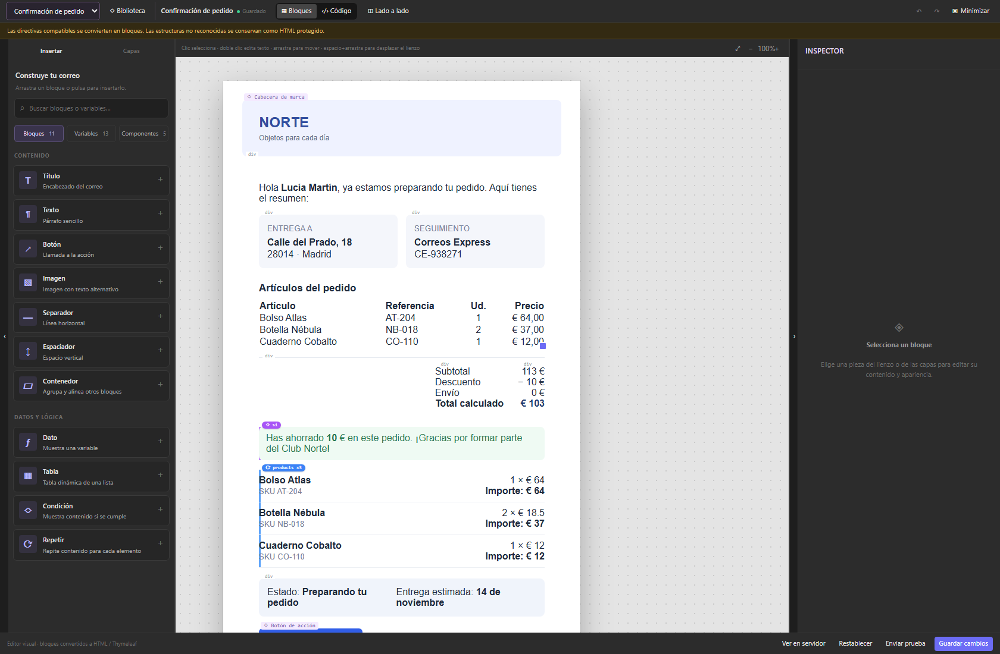

## 2. Insertar contenido

| Categoría | Contenido |
| --- | --- |
| Bloques | Título, texto, botón, imagen, separador, espaciador, contenedor, dato, tabla, condición y repetición |
| Variables | Datos de ejemplo con tipos, objetos y arrays desplegables |
| Componentes | Instancias vinculadas a una biblioteca compartida |

Pulsa una tarjeta de bloque para añadirla o arrástrala al lienzo. Los componentes se insertan pulsando su tarjeta. La búsqueda encuentra contenido por nombre, descripción o ruta.

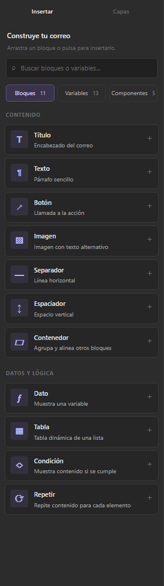

## 3. Leer los datos disponibles

Los tipos se infieren de las muestras: texto, número, booleano, objeto, array, `null` o sin muestra. No constituyen un esquema validado por el backend.

Los arrays muestran el tamaño, los tipos observados y la estructura del **primer elemento**. Un array vacío no permite deducir sus campos. `products[].name` describe la estructura; no es una expresión insertable. Dentro de una repetición, el campo del elemento actual se expresa como `item.name`.

La búsqueda conserva los objetos padres para que se entienda dónde está cada propiedad. Pulsa **+** para insertar un valor admitido en el contexto actual.

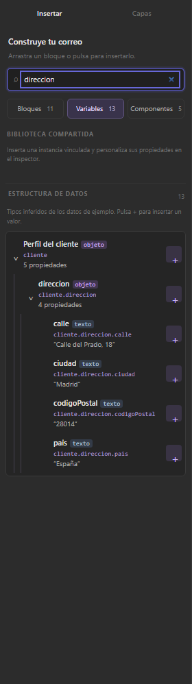
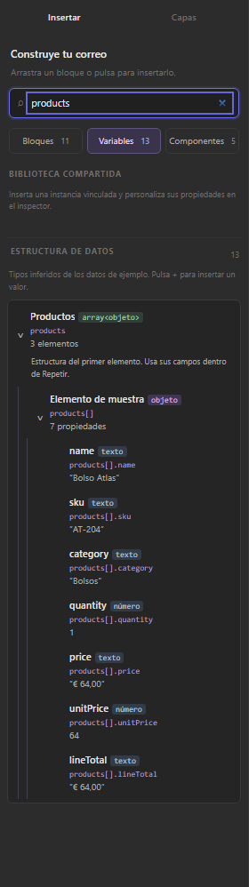

## 4. Escribir con T | ƒ

| Modo | Interpretación | Ejemplo |
| --- | --- | --- |
| T | Texto literal | `Pendiente de confirmar` |
| ƒ | Variables, cálculos y texto interpolado | `Pedido ${pedido}` |

En **T**, `${pedido}` mantiene esos caracteres como texto. En **ƒ**, se resuelve con el contexto disponible. Los campos necesariamente dinámicos, como el array de origen, muestran `${…}` sin selector de texto fijo.

```text
${item.sku}
${item.quantity * item.unitPrice}
${item.quantity * item.unitPrice} €
Pedido ${pedido} · ${cliente.nombre}
```

Usa **↑/↓** para recorrer sugerencias, **Tab/Intro** para aceptar y **Esc** para cerrar. El autocompletado introduce `${…}` donde corresponde. El texto y los espacios alrededor de una variable se conservan.

Los textos enriquecidos usan la misma notación. El parser sigue aceptando `{{nombre}}` y `{{= cálculo}}`; al editar se presenta `${…}`. El modelo interno puede guardar una expresión sin delimitadores: eso no cambia el formato que muestra el campo.

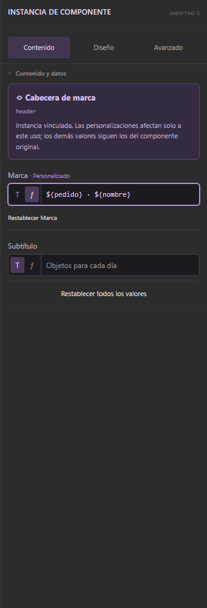

## 5. Seleccionar y mover

Pulsa un bloque del centro para seleccionarlo y abrir sus propiedades. Haz doble clic en texto editable para escribir. Mantén pulsado y mueve un bloque para reordenarlo. El indicador de inserción señala el destino; en contenedores compatibles permite anidar contenido.

En **Capas**, inicia el arrastre desde el nombre o la fila de un bloque, además del asa. Un clic sigue seleccionando. Desplegar, eliminar y subir/bajar tienen controles independientes.

Las filas estructurales de columnas y fuentes de tabla controlan esa tabla: no son bloques independientes que se puedan extraer. Las columnas se arrastran desde sus tarjetas del inspector.

**Expandir todo** y **Contraer todo** controlan el árbol. La búsqueda revela los grupos padres necesarios para localizar coincidencias, incluso si estaban contraídos.

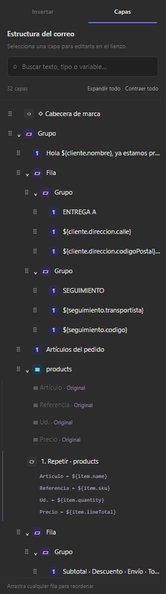
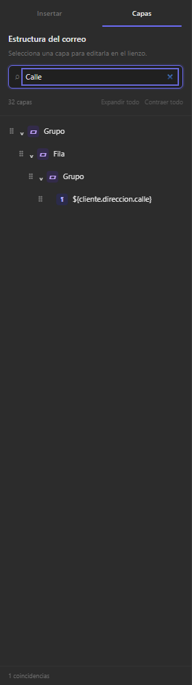

## 6. Configurar tablas

Selecciona una tabla o columna. **Contenido** ofrece **Columnas**, **Filas** y **Resultado**. **Diseño** contiene apariencia y estilos generales; **Avanzado**, CSS y atributos.

### Columnas: estructura y presentación

Cada columna tiene un identificador estable, etiqueta visible, alineación, ancho y formato. Añadir un campo crea la columna; cada grupo de filas define después su valor. El identificador debe ser una ruta sencilla, como `sku` o `importe`, sin duplicados.

Arrastra el asa de su tarjeta para reordenar o usa subir/bajar. El valor sigue asociado al identificador: cambiar el orden no modifica su fuente ni fórmula.

Los formatos son **Texto / original**, **Número** y **Moneda (€)**, con decimales, prefijo y sufijo. Afectan a los valores dinámicos. El texto fijo se conserva literalmente.

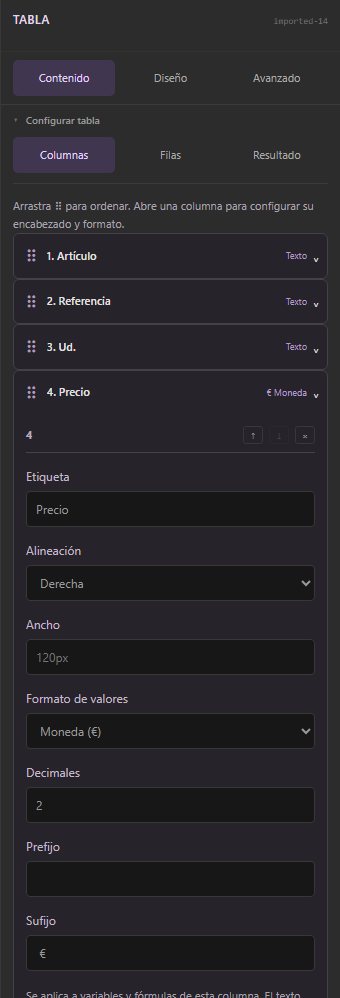

### Filas: valores y procedencia

Una tabla combina grupos en orden:

| Grupo | Resultado |
| --- | --- |
| Filas de array | Una fila por elemento del array elegido |
| Otro array | Otro grupo independiente con sus propias asignaciones |
| Fila única | Texto fijo, variables globales o cálculos en una sola fila |

Todos comparten cabecera. En cada array, `item` representa su propio elemento. Una fila única no recibe el `item` de un grupo anterior.

Ejemplo de productos y envío:

1. Define Artículo, Referencia, Unidades e Importe.
2. Elige `${products}` como origen del primer grupo.
3. Asigna `${item.name}`, `${item.sku}`, `${item.quantity}` y `${item.quantity * item.unitPrice}`.
4. Configura Importe como moneda con dos decimales.
5. Añade una **Fila única**: `Envío` en T y `${costeEnvio}` en ƒ en la columna Importe.
6. En **Resultado**, comprueba las cuatro filas: tres productos de muestra y envío.

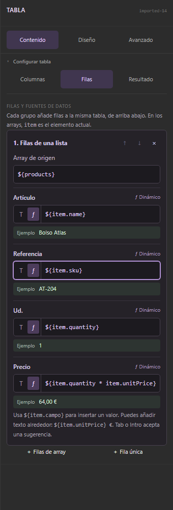
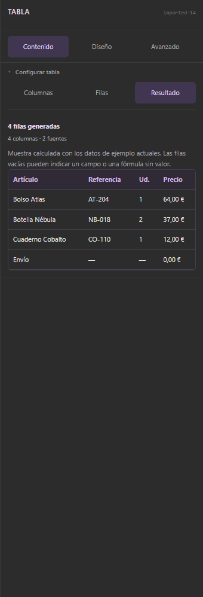

También puedes escribir `${item.unitPrice} €`. El texto compuesto controla su presentación y no vuelve a recibir el sufijo de moneda de la columna. Un marcador único, sin texto adicional, sí puede aplicar el formato de columna. No añadas otro `€` a un dato que ya venga formateado como texto (`€ 64,00`).

Los arrays vacíos generan cero filas, pero se mantienen las filas únicas. Una celda sin muestra puede indicar una propiedad inexistente o una expresión incompleta. **Resultado** muestra hasta 20 filas y no modifica el documento.

Se ha eliminado **Dividir en dos tablas**. La combinación de fuentes se configura dentro de una sola tabla.

## 7. Componentes compartidos

La demo incluye cabecera, pie legal, botón de acción, aviso y firma. En **Insertar → Componentes**, pulsa una tarjeta para añadir una instancia.

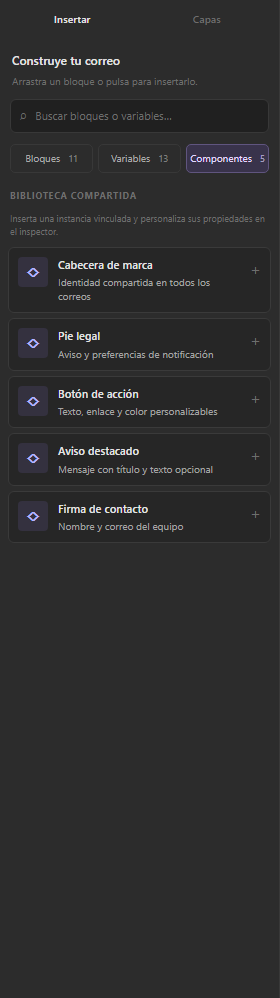

Al seleccionarla, el inspector muestra propiedades fijas o conectadas con ƒ. **Personalizado** indica un valor local. **Restablecer** elimina esa personalización y vuelve a seguir el original.

**Biblioteca**, arriba, abre los originales. Cambiar un valor predeterminado se refleja en los usos que no lo han personalizado, también en los otros correos. Las personalizaciones locales se conservan. El HTML compartido se edita en su pestaña. **Crear componente** añade una definición inicial con una propiedad `title`; el gestor no es un editor completo de esquemas de propiedades.

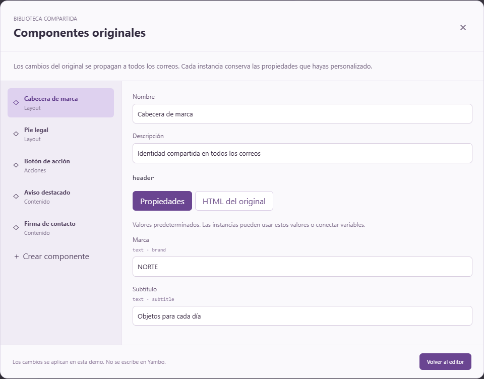

Este modelo se inspira en componentes e instancias de Figma, pero no conecta con Figma ni escribe en Yambo. Véase [Componentes e integración](COMPONENTS.md).

## 8. Diseño, código y preview

El inspector separa contenido, diseño y configuración avanzada para no mostrar todos los campos a la vez.

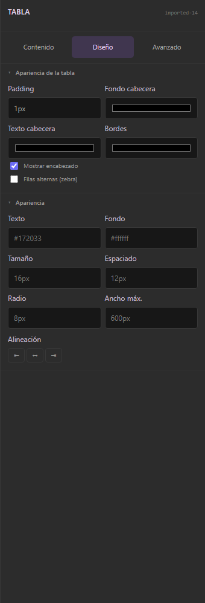
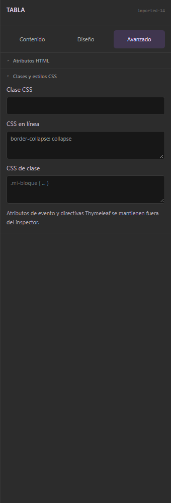

**Código** abre Monaco con HTML/Thymeleaf. Las estructuras reconocidas pueden volver a bloques; el HTML no reconocido queda protegido. No toda plantilla arbitraria se convierte en bloques editables.

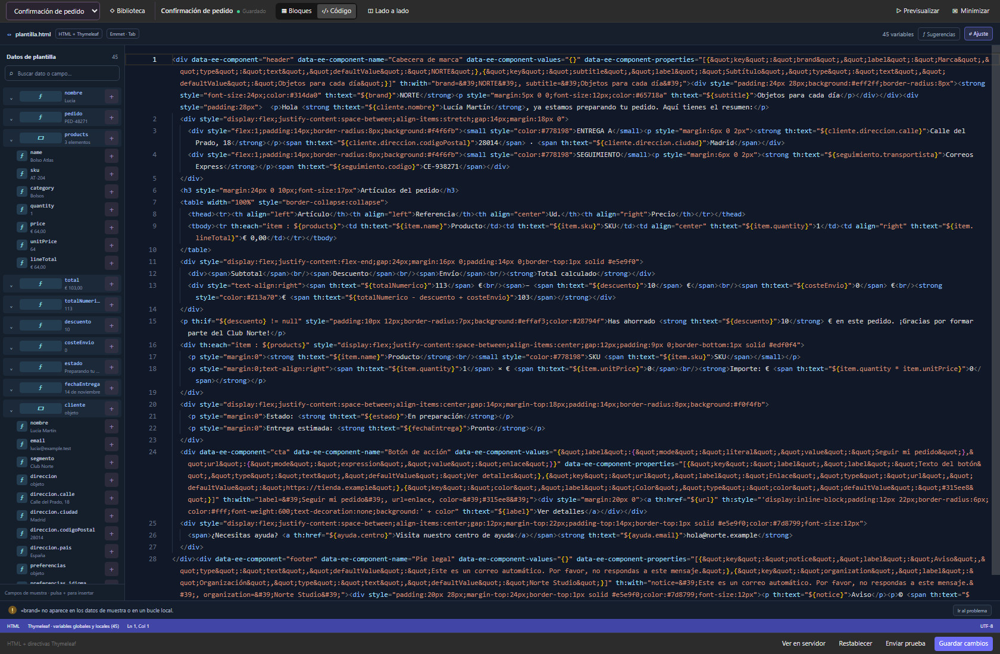

**Lado a lado** añade preview sin cambiar el modo de edición. Las opciones de 600 px y 375 px ajustan el dispositivo de referencia, pero el panel disponible puede limitar la vista de escritorio. El modo móvil reduce el ancho del mismo HTML; no rediseña automáticamente el correo.

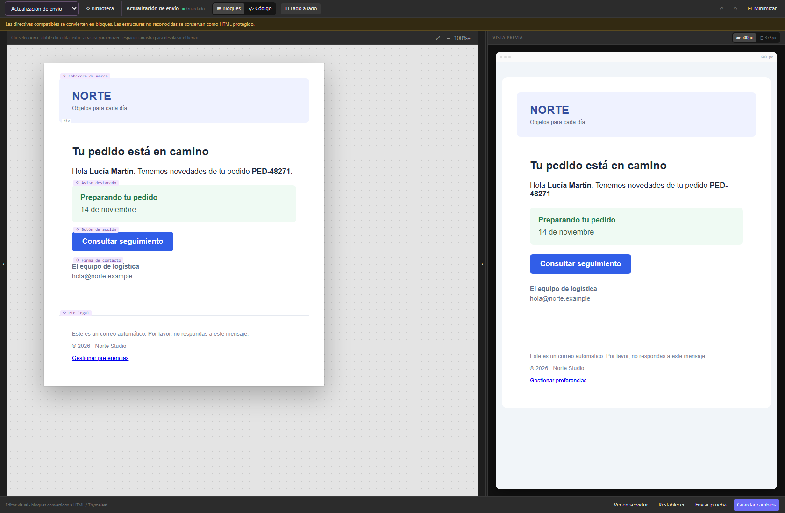
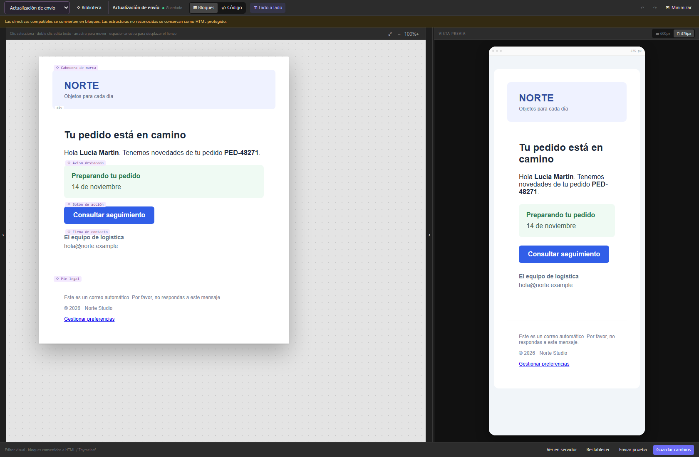

## 9. Teclado y navegación

| Acción | Control |
| --- | --- |
| Selección adicional | Mayús + clic |
| Editar texto del lienzo | Doble clic |
| Deshacer / rehacer | Ctrl/Cmd + Z; Ctrl/Cmd + Y o Ctrl/Cmd + Mayús + Z |
| Duplicar | Ctrl/Cmd + D |
| Subir / bajar seleccionado | ↑ / ↓ fuera de campos |
| Eliminar | Supr / Retroceso fuera de campos |
| Desplazar lienzo | Rueda; espacio + arrastre; botón central + arrastre |
| Zoom | Ctrl/Cmd + rueda o controles del lienzo |
| Aceptar sugerencia | Tab / Intro |
| Cerrar sugerencias | Esc |

Los inputs y controles de modo tienen nombres accesibles, foco visible y estados seleccionados. El árbol usa botones enfocables y alternativas para ordenar; no implementa todas las interacciones de un widget ARIA `tree`. La validación actual no es una auditoría completa con lectores de pantalla.

## 10. Guardado y límites

Guardar, enviar pruebas y renderizar en servidor son callbacks simulados. Documentos y biblioteca viven en memoria: recargar reinicia la demo. No hay autoguardado persistente ni sincronización entre pestañas.

La preview implementa un subconjunto de Thymeleaf; no ejecuta todo SpringEL ni el dialecto Layout completo. Antes de enviar, valida el resultado con el motor del servidor y los clientes de correo objetivo.
